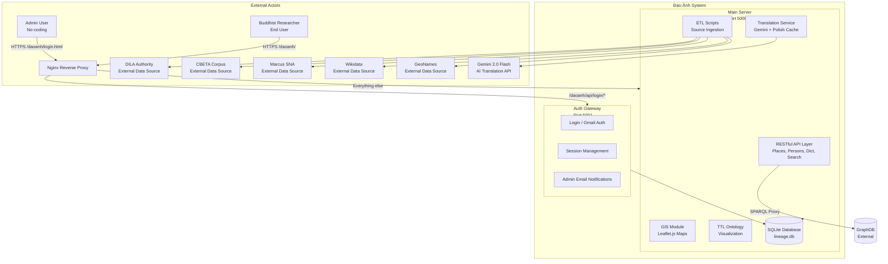
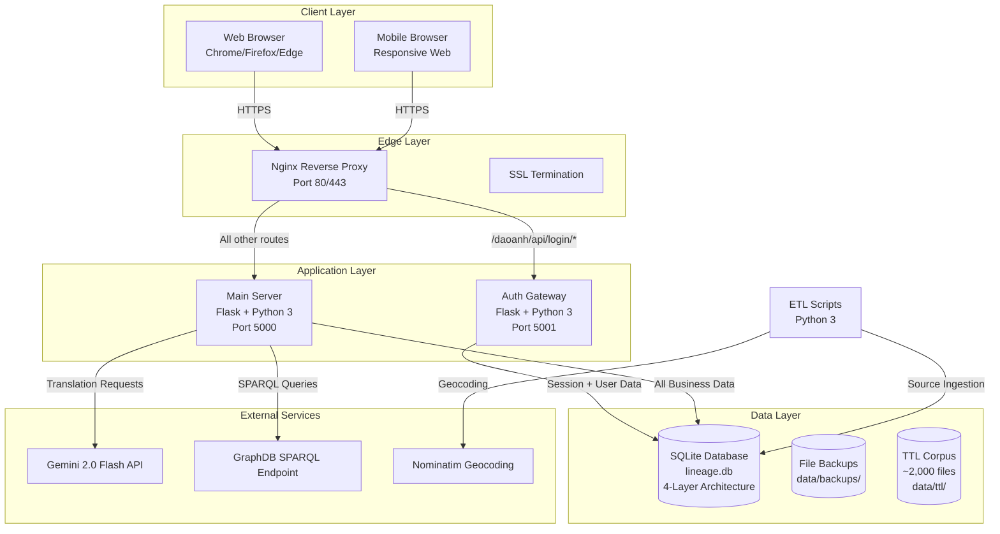
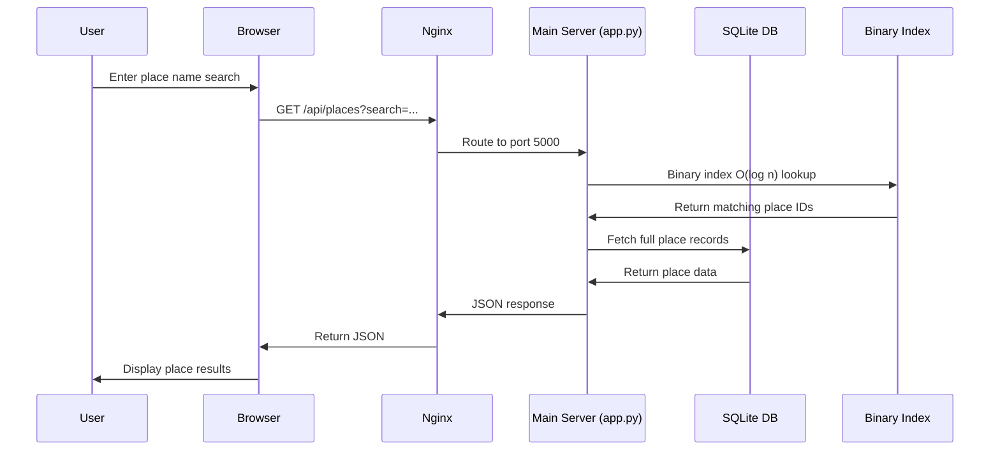
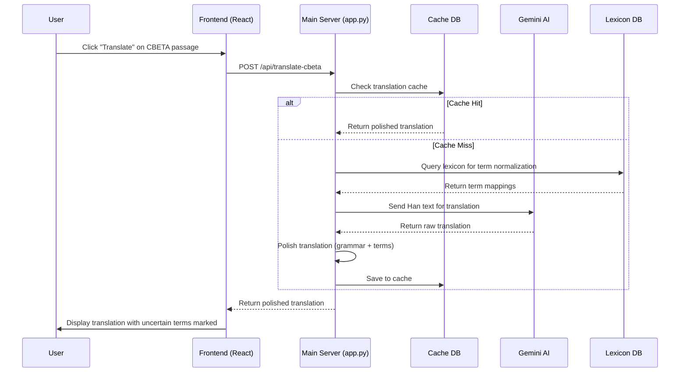
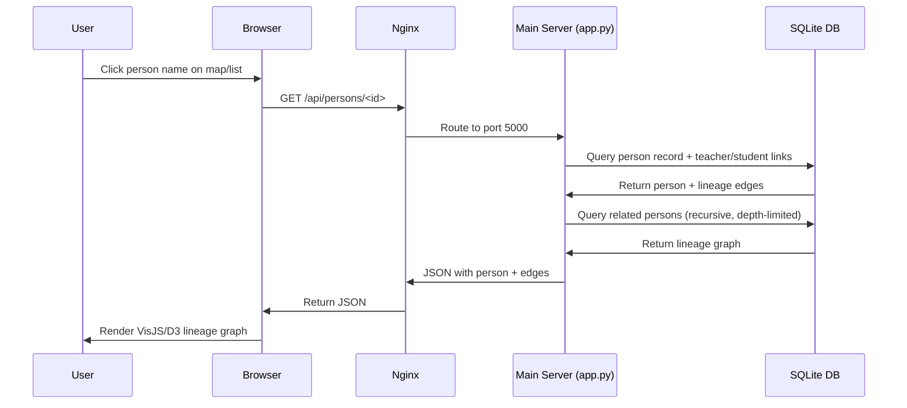

# 02-Solution-Architecture.md

# Solution Architecture Document (SAD) — Đạo Ảnh / Tuệ Giác Số

**Document ID:** SAD-02  
**Version:** 1.0  
**Date:** 2026-10-08  
**Status:** Draft  
**Classification:** Internal — Enterprise Architecture  

---

## Architecture Overview

### System Purpose

Đạo Ảnh is a Buddhist knowledge management and GIS platform that integrates authority data from multiple sources (DILA, CBETA, Marcus, Wikidata, GeoNames, internal TTL corpus) to enable place-person-time (nexus) queries for Buddhist historical research. The system serves administrative users for data curation and public users for place/person lookup and map visualization.

### Architecture Style

**Architecture Style:** Layered Monolith with Two-Server Split  
**Confidence:** 85%  
**Reasoning:** The system runs as a single codebase (app.py ~2,600 lines) deployed as two server processes (auth gateway on port 5001, main business logic on port 5000). Data flows through a layered architecture (RAW → STAGING → FINAL → INDEX). While there are adapter patterns for source integration, the deployment unit is monolithic rather than microservices.

### Business Domain

**Domain:** Buddhist Studies Digital Humanities  
**Sub-domains:**
- Place Authority Management (DILA places, Vietnamese temples, GPS cross-refs)
- Person Authority Management (DILA persons, Marcus SNA, Vietnamese TTL persons)
- Time Authority (Chinese/Vietnamese dynasties, era names, JDN conversion)
- Text Authority (CBETA canon, passages, citations)
- GIS Visualization (Leaflet.js maps, place clustering)
- Translation Services (Gemini AI, CBETA→Vietnamese polish, cache)
- Authentication & Authorization (Gmail login, session management, admin emails)

---

## Architecture Principles

| Principle | Description |
|-----------|-------------|
| **P1: Zero-RAM** | Never load full datasets into memory; use streaming, byte-offset mapping, binary indexes (O(log n)) |
| **P2: Additive-Only** | Database migrations only add columns/tables; no destructive changes without backup + manifest |
| **P3: Source-Agnostic** | New sources added via registry + adapter pattern without modifying core code |
| **P4: DILA Canonical** | DILA ID is the primary key; external IDs are cross-references only |
| **P5: Two-Server Split** | Auth gateway (5001) separated from business logic (5000) for security isolation |
| **P6: HITL Governance** | Human-in-the-loop canonical decisions for entity conflicts and source legal status |
| **P7: Read-Only Raw** | Raw source data never modified by the application |
| **P8: Additive + Reversible** | Every script has `--undo` + backup; revert tested before apply |

---

## Context Diagram



---

## Container Diagram



---

## Component Diagram

```mermaid
graph TD
    subgraph Main_Server_Components[Main Server — app.py Components]
        subgraph API_Layer[API Layer]
            PlacesAPI[GET /api/places]
            PersonsAPI[GET /api/persons]
            DictAPI[GET /api/dict/*]
            AdminAPI[GET /api/admin/*]
            CrawlerAPI[POST /api/crawler/*]
            HealthAPI[GET /api/health]
            GraphDBProxy[POST /api/graphdb/sparql]
            SearchAPI[GET /api/deepsearch, /api/nexus/find]
            EntityLinkAPI[POST /api/entity/link]
        end

        subgraph Business_Logic[Business Logic]
            PlaceMapper[Place-Person Mapper]
            EntityResolver[Entity Resolver<br/>DILA ID Canonical]
            NexusFinder[Nexus Point Finder]
            SearchEngine[Deep Search Engine]
            AuthChecker[Authorization Checker]
        end

        subgraph Data_Access[Data Access Layer]
            SQLiteConn[SQLite Connection<br/>Zero-RAM Streaming]
            BinaryIdx[Binary Index<br/>O(log n) Lookup]
            RawLayer[RAW Layer<br/>Read-Only Source Data]
            StagingLayer[STAGING Layer<br/>ETL + Mapping]
            FinalLayer[FINAL Layer<br/>UI-Consumed Tables]
        end

        subgraph Integration[Integration Layer]
            DILAAdapter[DILA Source Adapter]
            CBETAAdapter[CBETA Source Adapter]
            MarcusAdapter[Marcus Source Adapter]
            WikidataAdapter[Wikidata Source Adapter]
            GeoNamesAdapter[GeoNames Source Adapter]
        end
    end

    subgraph Auth_Gateway_Components[Auth Gateway — server.py Components]
        LoginHandler[Login Handler<br/>Gmail Verification]
        SessionMgr[Session Manager]
        EmailSvc[Email Service<br/>Admin Notifications]
    end

    subgraph Frontend_Components[Frontend Components]
        PlaceVN[placevn.html<br/>Place Mapping Admin]
        Panorama[panorama.html<br/>TTL Visualization]
        NameVi[namevimap.html<br/>Bulk Name Mapping]
        SearchAll[search_all.html<br/>Cross-Table Search]
        LoginPage[login.html<br/>Auth Gateway UI]
    end

    API_Layer --> Business_Logic
    Business_Logic --> Data_Access
    Data_Access --> RawLayer
    Data_Access --> StagingLayer
    Data_Access --> FinalLayer
    Integration --> DILAAdapter
    Integration --> CBETAAdapter
    Integration --> MarcusAdapter
    Integration --> WikidataAdapter
    Integration --> GeoNamesAdapter
    Auth_Gateway_Components --> SQLiteConn
    PlaceVN --> PlacesAPI
    Panorama --> PersonsAPI
    NameVi --> DictAPI
    SearchAll --> SearchAPI
    LoginPage --> LoginHandler
```

---

## Integration Architecture

### Inbound Integrations

| Source | Protocol | Endpoint | Data Type | Frequency |
|--------|----------|----------|-----------|-----------|
| DILA Authority | File import + API | Local filesystem | Places, Persons, Time | Batch (additive) |
| CBETA Corpus | XML parser | Local filesystem | Texts, Citations | Batch (planned) |
| Marcus SNA | File import | Local filesystem | Person networks, Glossaries | Batch |
| Wikidata | SPARQL | query.wikidata.org | GPS, Cross-refs | On-demand (T0) |
| OpenStreetMap | Overpass API | overpass-api.de | Vietnamese temple GPS | On-demand (T1) |
| disantongiao.vn | Web crawler | Static HTML table | Temple data | Batch (T2) |
| Gemini AI | REST API | generativelanguage.googleapis.com | Translation | On-demand |

### Outbound Integrations

| Target | Protocol | Endpoint | Purpose |
|--------|----------|----------|---------|
| GraphDB | SPARQL POST | localhost:7200 | RDF/TTL ontology queries |
| Nginx | HTTP Reverse Proxy | /daoanh/* | Route traffic to port 5000/5001 |
| Nominatim | HTTP GET | nominatim.openstreetmap.org | Geocoding Vietnamese temples |
| Google Translate | HTTP | translate.googleapis.com | Fallback translation |

### External Dependencies

| Dependency | Version | Purpose | Criticality |
|------------|---------|---------|-------------|
| Flask | Python 3 | Web framework | Critical |
| Python 3.11+ | Runtime | Application runtime | Critical |
| SQLite | Database | Data storage | Critical |
| Leaflet.js | CDN | Map visualization | High |
| React 18 | UMD + Babel | Frontend UI | High |
| Tailwind CSS | CDN | Styling | Medium |
| Gemini 2.0 Flash | API | AI translation | Medium |
| GraphDB | SPARQL | RDF storage | Low (optional) |

---

## Data Flow

### Place Lookup Flow



### Translation Flow (CBETA→Vietnamese)



### Person-Person Lineage Flow



---

## Security Architecture

### Authentication

- **Auth Gateway (Port 5001):** Gmail-based login verification
- **Session Management:** Server-side sessions with secure cookies
- **Route Protection:** `/daoanh/api/login/*` routed to port 5001; all other routes to port 5000
- **Admin Routes:** `/daoanh/api/admin/*` require authenticated admin session

### Authorization

- **Role-Based Access:** Admin vs. public user
- **Admin Only:** Data import, source legal checks, canonical decisions, translation approval
- **Public Read:** Place lookup, person search, GIS map, dictionary search
- **HITL Decisions:** Admin approval required for entity canonical status and source activation

### Encryption

- **Transport:** HTTPS via Nginx SSL termination
- **API Keys:** Gemini API key stored in environment variable, never committed
- **Session:** Secure cookie flags (HttpOnly, SameSite)

### Secrets Management

- **Gemini API Key:** Environment variable (per opencode-directives R6)
- **No hardcoded secrets:** All keys externalized
- **Backup security:** Backup files contain data but no API keys

### Audit Logging

- **Source legal status changes:** Tracked in `data_sources` table
- **Canonical decisions:** Recorded with admin user and timestamp
- **Data imports:** ETL run manifests with backup paths
- **Person import:** XML validation, commit/revert with run-id tracking

---

## Scalability

| Dimension | Current State | Scaling Strategy |
|-----------|--------------|------------------|
| **Data Volume** | 59K places, 48K persons, 166K dictionary terms | Binary index O(log n); SQLite sufficient for current scale |
| **Concurrent Users** | Single worktree, shared sessions | Nginx reverse proxy; Flask development server (production needs WSGI) |
| **API Requests** | Rate limited: 100 req/min (search), 60 req/min (admin) | Nginx rate limiting; future: Redis caching |
| **Geocoding** | Wikidata T0 + OSM T1 + Nominatim T2 | Cache results; batch processing |
| **Translation** | Gemini API with cache | Translation cache DB prevents redundant API calls |

---

## Availability

| Component | Availability | Strategy |
|-----------|-------------|----------|
| **Auth Gateway** | Single instance (port 5001) | Restart script: `pkill -f server.py && python server.py &` |
| **Main Server** | Single instance (port 5000) | Restart script: `fuser -k 5000/tcp && nohup python app.py &` |
| **SQLite Database** | Single file (lineage.db) | File-level backups in `data/backups/` |
| **Nginx** | Reverse proxy | Standard Nginx availability patterns |

**Note:** No high-availability clustering currently implemented. Single points of failure exist for both servers and database.

---

## Maintainability

| Aspect | Approach |
|--------|----------|
| **Documentation** | Comprehensive docs/ directory with 200+ markdown files |
| **Code Organization** | app.py (~2,600 lines), server.py (~125 lines), scripts/ directory |
| **Testing** | npm run pipeline (guard + dup:ids + lint + test + e2e + runtime) |
| **Task Tracking** | docs/tasktodo.md with TXXX task IDs |
| **Session Logs** | docs/sessions/YYYY-MM-DD_TXXX-slug.md |
| **Handoff Convention** | docs/Handoff-YYYY-MM-DD.md with 10-section format |

---

## Risks

| Risk | Likelihood | Impact | Mitigation |
|------|-----------|--------|------------|
| **Single point of failure** | High | High | Documented restart procedures; file-level backups |
| **Git index.lock corruption** | Medium | High | Temp-index sync pattern; documented in AGENTS.md §14 |
| **DILA legal status change** | Medium | High | Source registry with legal audit; 5 active sources monitored |
| **Gemini API rate limits** | Medium | Medium | Translation cache; fallback to GoogleTranslator |
| **HEAD shift between sessions** | High | Medium | Careful staging discipline; --cacheinfo pattern |
| **No CI/CD pipeline** | Medium | Medium | npm run pipeline as manual gate before review |

---

## Technical Debt

| Item | Description | Priority |
|------|-------------|----------|
| **TD-01** | `entity_unified` has 8+ if/else branches hardcoded per-source | High (planned for Build 4+) |
| **TD-02** | Per-source route clones in app.py (6+ locations) | High (planned for Build 4+) |
| **TD-03** | Source-named columns in geo_cross_ref (7 columns) | Medium (planned for Build 4+) |
| **TD-04** | Duplicate `*_new` tables conflicting with 3-layer model | Medium (documented in SCHEMA.md) |
| **TD-05** | No RDF/OWL export endpoint (only file export) | Low (planned for 2027+) |
| **TD-06** | No Redis caching layer | Low (future scaling) |

---
