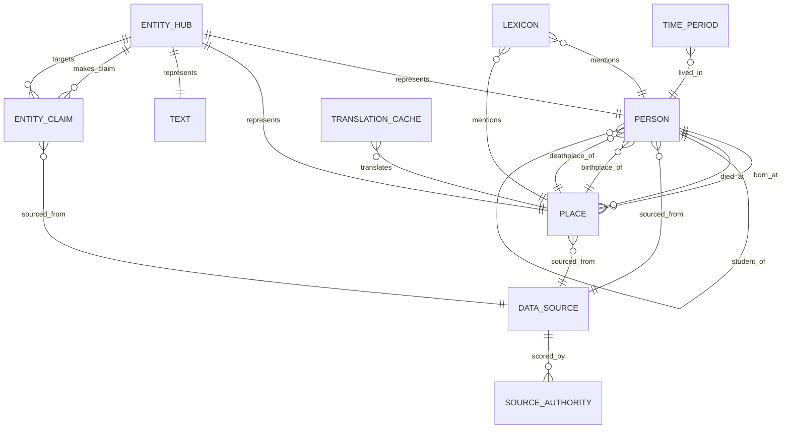

# 06-Database-Design.md

# Database Design — Đạo Ảnh / Tuệ Giác Số

**Document ID:** DBD-06  
**Version:** 1.0  
**Date:** 2026-10-08  
**Status:** Draft  
**Classification:** Internal — Enterprise Architecture  

---

## Database Overview

**Primary Database:** SQLite (`data/lineage.db`)  
**Architecture:** 3-Layer Model (RAW → STAGING/MAPPING → FINAL/PUBLIC) + INDEX Layer  
**Primary Key Strategy:** DILA ID (Axxxxx format for persons, PLxxxxxx for places)  
**Zero-RAM Principle:** Streaming + binary index (O(log n)); never load full datasets into memory  

---

## 3-Layer Data Model

| Layer | Purpose | Tables (Examples) | Modifiable by App |
|-------|---------|-------------------|-------------------|
| **RAW** | Source data — never modified | `people_full`, `places_dila`, `marcus_networks`, `dila_reference`, `marcus_reference`, `ttl_master`, `ttl_works` | ❌ No |
| **STAGING / MAPPING** | ETL, AI mapping, deduplication | `people_staging`, `places_staging`, `namevi_map_places_staging`, `places_pending` | ✅ Yes (ETL only) |
| **FINAL / PUBLIC** | Consumed by UI, exported downstream | `people`, `places`, `canon_catalog`, `places_vps`, `ttl_canon_works`, `ttl_mapping`, `lexicon`, `dataset_sources`, `source_authority` | ✅ Yes (UI actions) |
| **INDEX** | Binary search, O(log n) | `indexed/entity_master.idx` | ❌ No (generated) |

---

## Entity Definitions

### 1. Person (entities table)

**Description:** Buddhist person authority — monks, teachers, scholars with DILA ID as primary key.

| Attribute | Type | Required | Description |
|-----------|------|----------|-------------|
| `id` | TEXT | ✅ | DILA ID (format: A000001) |
| `names` | TEXT[] | ✅ | Person names (Vietnamese + Hán) |
| `pinyin` | TEXT | ❌ | Pinyin romanization |
| `birth` | TEXT | ❌ | Birth date (ISO or era format) |
| `death` | TEXT | ❌ | Death date (ISO or era format) |
| `birth_place` | TEXT | ❌ | Reference to Place ID |
| `death_place` | TEXT | ❌ | Reference to Place ID |
| `teacher` | TEXT[] | ❌ | List of teacher DILA IDs |
| `student` | TEXT[] | ❌ | List of student DILA IDs |
| `occupation` | TEXT | ❌ | Occupation (e.g., "禪宗") |
| `lineage` | TEXT | ❌ | Lineage path (e.g., "禪宗-南宗-六祖") |
| `sources` | TEXT[] | ❌ | Source texts |
| `dynasty` | TEXT | ❌ | Dynasty association |
| `sex` | INTEGER | ❌ | 1=Male, 2=Female, 9=Unknown, 0=Other |
| `ttl_filename` | TEXT | ❌ | Associated TTL file |
| `status` | TEXT | ✅ | Record status (pending, active, verified) |
| `source_id` | INTEGER | ✅ | FK to dataset_sources |

**Relationships:**
- Person → Teacher (Person, many-to-many via lineage)
- Person → Student (Person, many-to-many via lineage)
- Person → Birth Place (Place, many-to-one)
- Person → Death Place (Place, many-to-one)
- Person → Dynasty (Time, many-to-one)
- Person → Source (dataset_sources, many-to-one)

---

### 2. Place (places table)

**Description:** Buddhist place authority — temples, monasteries, sacred sites with GPS coordinates.

| Attribute | Type | Required | Description |
|-----------|------|----------|-------------|
| `id` | TEXT | ✅ | DILA ID (format: PLxxxxxx) or VN+10 for Vietnamese temples |
| `name` | TEXT | ✅ | Place name (Vietnamese + Hán) |
| `province` | TEXT | ❌ | Province/region |
| `lat` | REAL | ❌ | Latitude (GPS) |
| `lng` | REAL | ❌ | Longitude (GPS) |
| `source` | TEXT | ✅ | Data source (DILA, Wikidata, OSM, etc.) |
| `verified` | BOOLEAN | ✅ | Verification status |
| `bbox_ok` | BOOLEAN | ❌ | Within Vietnam bounding box |
| `bad_id` | INTEGER | ❌ | Bad ID flag (0=ok) |
| `geonames_id` | TEXT | ❌ | GeoNames cross-reference |
| `wikidata_qid` | TEXT | ❌ | Wikidata cross-reference |
| `source_id` | INTEGER | ✅ | FK to dataset_sources |

**Relationships:**
- Place → Persons (Person, one-to-many via birth/death place)
- Place → Source (dataset_sources, many-to-one)
- Place → GeoNames (external, many-to-one)
- Place → Wikidata (external, many-to-one)

---

### 3. Entity Hub (entity_hub table)

**Description:** Central entity table unifying persons, places, and texts (167,006 entities).

| Attribute | Type | Required | Description |
|-----------|------|----------|-------------|
| `entity_id` | TEXT | ✅ | DILA_ID (canonical) |
| `entity_type` | TEXT | ✅ | PERSON / PLACE / TEXT |
| `dila_id` | TEXT | ✅ | DILA identifier |
| `alias_vi` | TEXT | ❌ | Vietnamese alias |
| `alias_zh` | TEXT | ❌ | Hán/Chinese alias |
| `cbeta_occ` | TEXT | ❌ | CBETA occurrence ID |
| `marcus_id` | TEXT | ❌ | Marcus SNA ID |
| `extra_alias` | TEXT/JSON | ❌ | Additional name variants |

**Relationships:**
- EntityHub → Person (one-to-one, via entity_id)
- EntityHub → Place (one-to-one, via entity_id)
- EntityHub → Text (one-to-one, via entity_id)
- EntityHub → Source IDs (one-to-many, via entity_source_ids)

---

### 4. Entity Claims (entity_claims table)

**Description:** Data assertions linking entities to sources with provenance (447,885 claims).

| Attribute | Type | Required | Description |
|-----------|------|----------|-------------|
| `claim_id` | INTEGER | ✅ | Auto-increment primary key |
| `entity_id` | TEXT | ✅ | DILA entity ID |
| `predicate` | TEXT | ✅ | Claim predicate (e.g., "birthPlace", "teacher") |
| `object_dila_id` | TEXT | ✅ | Target entity DILA ID |
| `source` | TEXT | ✅ | Source of claim |
| `source_reference` | TEXT | ✅ | Provenance reference |
| `confidence` | REAL | ❌ | Confidence score (0.0-1.0) |
| `verified` | BOOLEAN | ✅ | Verification status |

**Relationships:**
- EntityClaim → EntityHub (many-to-one, via entity_id)
- EntityClaim → EntityHub (many-to-one, via object_dila_id)
- EntityClaim → Source (many-to-one, via source)

---

### 5. Data Sources (data_sources table)

**Description:** Source registry with legal audit metadata (13 sources).

| Attribute | Type | Required | Description |
|-----------|------|----------|-------------|
| `source_code` | TEXT | ✅ | Source code (DILA, CBETA, MARCUS, etc.) |
| `authority_score` | INTEGER | ✅ | Authority score (0-100) |
| `precedence_order` | INTEGER | ✅ | Precedence order (0-based) |
| `implemented` | BOOLEAN | ✅ | Whether source is implemented |
| `legal_status` | TEXT | ✅ | AUDITING, ACTIVE, BLOCKED, DEFERRED, REFERENCE_ONLY, LEGACY |
| `license_spdx` | TEXT | ❌ | SPDX license identifier |
| `data_license_status` | TEXT | ❌ | Data license status |
| `license_verified` | BOOLEAN | ✅ | License verification status |
| `version_policy` | TEXT | ❌ | Version pinning policy |
| `integration_mode` | TEXT | ✅ | INGEST, REFERENCE_ONLY, BLOCKED |

---

### 6. Source Authority (source_authority table)

**Description:** Authority scoring for data source precedence (13 sources).

| Attribute | Type | Required | Description |
|-----------|------|----------|-------------|
| `source_code` | TEXT | ✅ | Source code |
| `authority_score` | INTEGER | ✅ | Score (0-100) |
| `precedence_order` | INTEGER | ✅ | 0-based precedence |
| `implemented` | BOOLEAN | ✅ | Implementation status |

**Source Authority Ranking:**

| Source | Score | Precedence | Level | Implemented |
|--------|-------|------------|-------|-------------|
| DILA | 100 | 1 | L1-Primary | Yes |
| CBETA | 80 | 2 | L1-Primary | Yes |
| SAT | 75 | 3 | L2 | No |
| Kanripo | 70 | 9 | L2 | No |
| MARCUS | 60 | 4 | L2 | Yes |
| CHGIS | 58 | 5 | L2-GIS | No |
| TGAZ | 55 | 10 | L2-GIS | No |
| ZQLOCAL | 50 | 0 | L2 (internal) | Yes |
| SuttaCentral | 50 | 11 | L2 | No |
| 84000 | 45 | 12 | L2 | No |
| BDRC | 40 | 6 | L3 | No |
| FoJin | 40 | 7 | L3 | No |
| Wikidata | 25 | 8 | L3-REFERENCE_ONLY | No |

---

### 7. Lexicon (lexicon table)

**Description:** StarDict dictionary entries (166,278 entries, 22 dictionaries).

| Attribute | Type | Required | Description |
|-----------|------|----------|-------------|
| `term` | TEXT | ✅ | Dictionary term |
| `definition` | TEXT | ✅ | Definition |
| `source` | TEXT | ✅ | Dictionary source |
| `entity_type` | TEXT | ❌ | ĐỊA DANH (place), etc. |
| `confidence` | REAL | ❌ | Match confidence |

**Statistics:** 15,863 entries with entity_type='ĐỊA DANH'

---

### 8. Translation Cache (place_cbeta_translations)

**Description:** CBETA translation cache (planned, from Roadmap Phase 7).

| Attribute | Type | Required | Description |
|-----------|------|----------|-------------|
| `id` | INTEGER | ✅ | Auto-increment primary key |
| `place_id` | TEXT | ✅ | Place DILA ID |
| `cbeta_ref` | TEXT | ✅ | CBETA reference (T50n2060_p0480b14) |
| `han_source` | TEXT | ✅ | Han source text |
| `raw_translation` | TEXT | ✅ | Raw Gemini translation |
| `polished_text` | TEXT | ✅ | Polished Vietnamese translation |
| `translation_status` | TEXT | ✅ | draft, admin_approved, user_generated, auto_generated |
| `confidence_score` | REAL | ❌ | Confidence (0.0-1.0) |
| `created_at` | TIMESTAMP | ✅ | Creation timestamp |
| `created_by` | TEXT | ✅ | admin, user, batch_script |

**Unique Constraint:** (place_id, cbeta_ref)

---

### 9. Vietnamese Places (places_vn)

**Description:** Vietnamese temple GPS data (6,002+ records).

| Attribute | Type | Required | Description |
|-----------|------|----------|-------------|
| `id` | TEXT | ✅ | VN+10 format ID |
| `name` | TEXT | ✅ | Temple name |
| `province` | TEXT | ✅ | Vietnamese province |
| `lat` | REAL | ✅ | Latitude |
| `lng` | REAL | ✅ | Longitude |
| `source` | TEXT | ✅ | WIKIDATA, OPENSTREETMAP, DISANTONGIAO_VN |
| `verified` | BOOLEAN | ✅ | Verification status |
| `bbox_ok` | BOOLEAN | ✅ | Within Vietnam bounding box |
| `bad_id` | INTEGER | ✅ | Bad ID flag |

---

## ERD (Entity Relationship Diagram)



---

## Data Dictionary

| Table | Row Count | Primary Key | Description |
|-------|-----------|-------------|-------------|
| `people` | 48,803 | id (DILA ID) | Person authority records |
| `places` | 59,167+ | id (DILA ID) | Place authority records |
| `places_dila` | 59,167 | id | Raw DILA place data |
| `people_full` | 48,803 | id | Raw DILA person data |
| `places_vps` | 5,000+ | id | VPS place data |
| `places_vn` | 6,002+ | id (VN+10) | Vietnamese temple GPS |
| `places_pending` | 175,000 | id | Staging place records |
| `namevi_map_places` | 118,000 | - | Name-Vi mapping records |
| `lexicon` | 166,278 | term | Dictionary entries |
| `entity_hub` | 167,006 | entity_id | Central entity unification |
| `entity_claims` | 447,885 | claim_id | Data assertions with provenance |
| `data_sources` | 13 | source_code | Source registry |
| `source_authority` | 13 | source_code | Authority scoring |
| `marcus_networks` | - | - | Marcus SNA person networks |
| `marcus_reference` | - | - | Marcus glossary terms |
| `ttl_master` | - | - | TTL corpus master |
| `ttl_works` | - | - | TTL works catalog |

---

## Index Recommendations

| Table | Column(s) | Index Type | Reason |
|-------|-----------|------------|--------|
| `people` | `id` | PRIMARY KEY | DILA ID lookup |
| `people` | `dynasty` | B-TREE | Dynasty filtering |
| `people` | `birth` | B-TREE | Birth date range queries |
| `places` | `id` | PRIMARY KEY | DILA ID lookup |
| `places` | `lat, lng` | RTREE | GIS spatial queries |
| `places` | `province` | B-TREE | Province filtering |
| `places` | `source` | B-TREE | Source filtering |
| `entity_hub` | `entity_id` | PRIMARY KEY | Entity lookup |
| `entity_hub` | `entity_type` | B-TREE | Type filtering |
| `entity_claims` | `entity_id` | B-TREE | Claim lookup by entity |
| `entity_claims` | `object_dila_id` | B-TREE | Reverse claim lookup |
| `entity_claims` | `predicate, object_dila_id` | COMPOUND | Grouped conflict queries |
| `lexicon` | `term` | PRIMARY KEY | Term lookup |
| `lexicon` | `entity_type` | B-TREE | Entity type filtering |
| `data_sources` | `source_code` | PRIMARY KEY | Source lookup |
| `data_sources` | `legal_status` | B-TREE | Legal status filtering |
| `source_authority` | `authority_score` | B-TREE | Score-based ordering |
| `translation_cache` | `place_id, cbeta_ref` | UNIQUE | Translation lookup |
| `translation_cache` | `translation_status` | B-TREE | Status filtering |

---

## Retention Considerations

| Data Type | Retention Policy | Rationale |
|-----------|-----------------|-----------|
| **RAW source data** | Permanent (never delete) | Zero-RAM principle; source data is immutable |
| **STAGING tables** | 90 days after ETL completion | Temporary; can be regenerated from source |
| **FINAL tables** | Permanent | Core application data |
| **Binary index** | Regenerable | Rebuild from FINAL tables if corrupted |
| **Backup files** | 30 days rolling | data/backups/ with run-id naming |
| **TTL files** | Permanent | 1,037+ exported TTL v2 files |
| **Translation cache** | Permanent | Avoids redundant Gemini API calls |
| **Session data** | 24 hours | Server-side sessions; cleanup on restart |
| **Error logs** | 90 days | flask.log, app_err.log, gateway logs |

---

## Migration Strategy

**Additive-Only Pattern:**
1. Create new table or add new column (never drop)
2. Backfill data from existing tables
3. Update application code to use new structure
4. Mark old structure as deprecated (do not remove immediately)
5. Remove deprecated structure only after full migration verified

**Example Migration (from SCHEMA.md):**
```sql
-- Rename staging tables
ALTER TABLE people_new RENAME TO people_staging;
ALTER TABLE places_new RENAME TO places_staging;

-- Consolidate mapping tables
INSERT OR IGNORE INTO namevi_map_places (dila_id, name_vi, name_zh, source, confidence)
SELECT dila_id, name_vi, name_zh, source, confidence FROM name_vi_map_places;
DROP TABLE name_vi_map_places;

-- Enforce source tracking
ALTER TABLE people ADD CONSTRAINT fk_source FOREIGN KEY (source_id) REFERENCES dataset_sources(id);
```

**Rollback Strategy:**
- Each ETL script has `--undo` + backup
- Manifest files in `docs/rollback/` for each migration
- DB copy used for governance testing before production apply
- `git revert --no-edit <sha>` for code rollback

---
