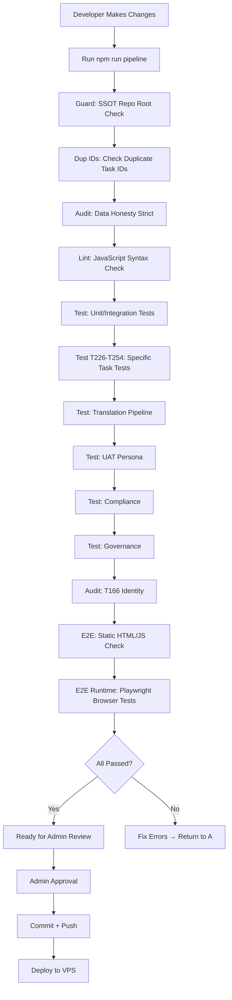

# 07-Deployment-Architecture.md

# Deployment Architecture — Đạo Ảnh / Tuệ Giác Số

**Document ID:** DEP-07  
**Version:** 1.0  
**Date:** 2026-10-08  
**Status:** Draft  
**Classification:** Internal — Enterprise Architecture  

---

## Environments

| Environment | Purpose | URL | Port | Database | Status |
|-------------|---------|-----|------|----------|--------|
| **Local** | Developer local testing | http://localhost:5000 | 5000 | `data/lineage.db` (local copy) | Active |
| **Auth Gateway (Local)** | Local login testing | http://localhost:5001 | 5001 | `data/lineage.db` (local copy) | Active |
| **Dev** | Feature development | http://dev.phatphaponline.org/daoanh | 5000 | Dev SQLite copy | Planned |
| **SIT** | System integration testing | http://sit.phatphaponline.org/daoanh | 5000 | SIT SQLite copy | Planned |
| **UAT** | User acceptance testing | http://uat.phatphaponline.org/daoanh | 5000 | UAT SQLite copy | Planned |
| **Staging** | Pre-production validation | http://staging.phatphaponline.org/daoanh | 5000 | Staging SQLite copy | Planned |
| **Production** | Live production system | https://phatphaponline.org/daoanh | 80/443 | `data/lineage.db` (VPS) | Active |

---

## Infrastructure Layout

```
┌─────────────────────────────────────────────────────────────┐
│                      External Users                          │
│              (Admin, Researchers, Buddhist Public)           │
└─────────────────────────────────────────────────────────────┘
                              │
                              ▼ HTTPS (Port 443)
┌─────────────────────────────────────────────────────────────┐
│                      Nginx Reverse Proxy                     │
│  Routes /daoanh/api/login/* → Port 5001 (Auth Gateway)      │
│  Routes everything else → Port 5000 (Main Server)          │
│  SSL Termination                                            │
│  Rate Limiting (100 req/min search, 60 req/min admin)      │
└─────────────────────────────────────────────────────────────┘
                              │
        ┌─────────────────────┴─────────────────────┐
        ▼                                           ▼
┌──────────────────┐                      ┌──────────────────┐
│  Auth Gateway    │                      │   Main Server    │
│  server.py:5001  │                      │   app.py:5000    │
│  (Flask + Python)│                      │  (Flask + Python)│
│  - Login only    │                      │  - All business    │
│  - Session mgmt  │                      │    logic         │
│  - Admin emails  │                      │  - API endpoints   │
└──────────────────┘                      └──────────────────┘
        │                                           │
        ▼                                           ▼
┌──────────────────┐                      ┌──────────────────┐
│  SQLite Database │                      │  SQLite Database │
│  data/lineage.db │                      │  data/lineage.db │
│  (shared file)   │                      │  (shared file)   │
└──────────────────┘                      └──────────────────┘
        │
        ▼
┌──────────────────┐
│  File Backups    │
│  data/backups/   │
│  (ETL run dumps) │
└──────────────────┘

External Integrations:
  • Gemini 2.0 Flash API (HTTPS) — Translation
  • GraphDB SPARQL (localhost:7200) — RDF queries
  • Nominatim (HTTPS) — Geocoding (VN temples)
  • Wikidata SPARQL (HTTPS) — Cross-reference data
  • OpenStreetMap Overpass (HTTPS) — Map data
```

---

## Network Zones

| Zone | Components | Access Control | Description |
|------|-----------|----------------|-------------|
| **Public Zone** | Nginx, Internet users | Port 80/443 open | External user access via HTTPS |
| **Application Zone** | Flask servers (5000, 5001) | Internal only (via Nginx) | Business logic and auth |
| **Data Zone** | SQLite database file | Local filesystem only | No network exposure |
| **External Zone** | Gemini API, GraphDB, Nominatim | Outbound HTTPS only | Third-party service access |

**Network Rules:**
- Inbound: Port 443 (HTTPS) → Nginx → Port 5000/5001
- Outbound: Port 443 (HTTPS) → External APIs
- Database: Local file access only (no TCP port exposed)
- No direct internet access to Flask servers (all via Nginx)

---

## Deployment Pipeline

### Pipeline Stages



### Pipeline Command

```bash
npm run pipeline
```

**Expanded:**
```
npm run guard && npm run dup:ids && npm run audit:honesty:strict &&
npm run lint && npm run test && npm run test:t226 && npm run test:t227 &&
npm run test:t232 && npm run test:t233 && npm run test:t253 &&
npm run test:t242 && npm run test:t243 && npm run test:t244 &&
npm run test:translation && npm run test:uat && npm run test:compliance &&
npm run test:gov && npm run audit:t166 && npm run e2e &&
npm run e2e:runtime
```

**Timeout:** ~10-15 minutes (depending on test count)  
**Gate:** Admin review only when "ALL TESTS PASSED" is shown

---

## CI/CD

| Component | Tool | Frequency | Trigger |
|-----------|------|-----------|---------|
| **Guard** | `npm run guard` | Every pipeline run | Pre-commit |
| **Duplicate ID Check** | `npm run dup:ids` | Every pipeline run | Pre-commit |
| **Data Honesty Audit** | `npm run audit:honesty:strict` | Every pipeline run | Pre-commit |
| **Lint** | `npm run lint` (ESLint) | Every pipeline run | Pre-commit |
| **Unit Tests** | `npm run test` | Every pipeline run | Pre-commit |
| **E2E Tests** | `npm run e2e` | Every pipeline run | Pre-commit |
| **E2E Runtime** | `npm run e2e:runtime` | Every pipeline run | Pre-commit |
| **Deployment** | Manual (restart script) | On admin approval | Post-review |

**No Automated CI/CD:** Deployment is manual via SSH to VPS:
```bash
# Main server restart
fuser -k 5000/tcp && nohup python3 app.py > flask.log 2>&1 &

# Auth gateway restart
pkill -f server.py && python3 server.py &
```

---

## Backup Strategy

| Backup Type | Frequency | Location | Retention |
|-------------|-----------|----------|-----------|
| **Database File** | Before each ETL run | `data/backups/lineage_tXXX_<timestamp>.db` | 30 days |
| **ETL Run Backup** | Each ETL execution | `data/backups/person-import-<run_id>/` | 30 days |
| **TTL Files** | After export | `data/backups/t205_ttl_<timestamp>/` | Permanent |
| **Git Repository** | On commit | `visjs-app/.git` | Permanent |
| **Session Logs** | Daily | `docs/sessions/YYYY-MM-DD/` | Permanent |
| **Handoff Reports** | Per session | `docs/Handoff-YYYY-MM-DD.md` | Permanent |

**Backup Verification:**
- TTL export: 1,037/1,037 RDF/SHA verified
- Person import: 4/4 unit tests + backup verified
- DB copy used for governance testing before production apply

---

## Disaster Recovery Strategy

| Scenario | RTO | RPO | Procedure |
|----------|-----|-----|-----------|
| **Server crash** | < 30 min | < 1 hour | Restart Flask on VPS; data intact in SQLite |
| **Database corruption** | < 1 hour | < 24 hours | Restore from latest `data/backups/` SQLite file |
| **Git index.lock failure** | < 15 min | < 1 hour | Temp-index sync pattern (AGENTS.md §14) |
| **Failed migration** | < 30 min | 0 data loss | Revert using manifest + `--undo` script |
| **DILA source blocked** | < 1 day | 0 data loss | Switch to ACTIVE sources; blocked source data preserved as LEGACY |
| **Gemini API outage** | < 1 hour | 0 data loss | Fallback to GoogleTranslator; use translation cache |

**Recovery Steps:**
1. Identify failure type from error logs (`app_err.log`, `gateway_local.err`)
2. Restore from most recent backup in `data/backups/`
3. Re-run ETL scripts with `--revert` if needed
4. Verify with `npm run tester:agent`
5. Admin approval before resuming operations

---

## Deployment Commands

### Start Servers (Local)

```bash
# Auth Gateway (port 5001)
python3 server.py

# Main Server (port 5000)
python3 app.py
```

### Restart Servers (VPS Production)

```bash
# Restart main server
fuser -k 5000/tcp && nohup python3 app.py > flask.log 2>&1 &

# Restart auth gateway
pkill -f server.py && python3 server.py &
```

### Run Full Pipeline

```bash
cd /opt/phatphakonline_gradio/truyenthua/visjs-app/Dai_Tang_Kinh/daoanh
npm run pipeline
```

### Git Operations (from repo root only)

```bash
# From visjs-app root (NOT daoanh/)
git rev-parse HEAD
git diff --cached --name-status
```

---

## Deployment Checklist

- [ ] Nginx configured for /daoanh/api/login/* → port 5001
- [ ] Nginx configured for all other routes → port 5000
- [ ] SSL certificate installed on Nginx
- [ ] SQLite database backed up before deployment
- [ ] `npm run pipeline` passed (all 4+ test stages)
- [ ] Admin review approval obtained
- [ ] Gemini API key configured as environment variable
- [ ] Rate limits configured (100/min search, 60/min admin)
- [ ] Backup directory `data/backups/` exists and writable
- [ ] Log files writable (flask.log, app.log, gateway logs)

---
