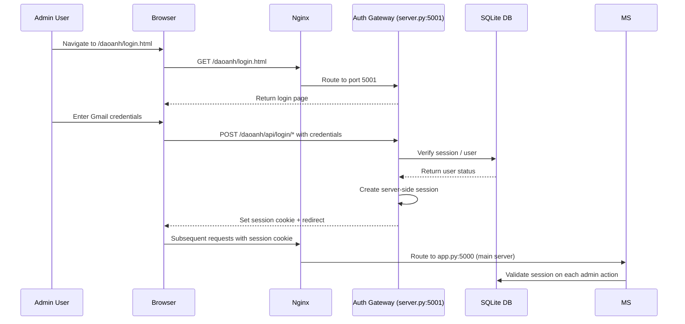

# 08-Security-Architecture.md

# Security Architecture — Đạo Ảnh / Tuệ Giác Số

**Document ID:** SEC-08  
**Version:** 1.0  
**Date:** 2026-10-08  
**Status:** Draft  
**Classification:** Internal — Security Architecture  

---

## Identity Management

### Identity Sources

| Identity Type | Source | Storage | Management |
|---------------|--------|---------|------------|
| **Admin Users** | Gmail verification | Server-side sessions | Auth Gateway (server.py:5001) |
| **System Accounts** | None (no user registration) | N/A | No public registration |
| **Service Accounts** | None | N/A | No service-to-service auth |
| **API Clients** | None (no public API keys) | N/A | All APIs session-based |

### Identity Lifecycle

1. **Registration:** None — admin accounts pre-configured
2. **Authentication:** Gmail-based login via Auth Gateway
3. **Authorization:** Session-based role checking (admin vs. public)
4. **Revocation:** Session termination on server restart
5. **Audit:** Session creation logged in server logs

---

## Authentication

### Auth Gateway (Port 5001)

**Component:** `server.py` (~125 lines, stripped from ~2,800 lines)  
**Role:** Login only — Gmail check, session management, admin emails

**Authentication Flow:**

**Authentication Methods:**
- **Primary:** Gmail-based login verification
- **Session:** Server-side sessions with secure cookies
- **Token:** None (stateless JWT not used)

### Authentication Requirements

| Requirement | Implementation | Location |
|-------------|---------------|----------|
| Login page | /daoanh/login.html | server.py:5001 |
| Login API | /daoanh/api/login/* | server.py:5001 |
| Session creation | Server-side Flask sessions | server.py |
| Session validation | Middleware on admin routes | app.py:5000 |
| Logout | Session destruction | server.py |

---

## Authorization

### Role-Based Access Control (RBAC)

| Role | Permissions | Routes |
|------|-------------|--------|
| **Public User** | Read-only: place search, person search, GIS map, dictionary | /api/places, /api/persons, /api/dict, /api/health |
| **Admin User** | Read + Write: data import, source legal checks, canonical decisions, translation approval | /api/admin/*, /daoanh/api/admin/*, /daoanh/admin/ |

### Route Protection

| Path Prefix | Handled By | Port | Auth Required |
|-------------|------------|------|---------------|
| /daoanh/login.html | server.py | 5001 | No |
| /daoanh/api/login/* | server.py | 5001 | No |
| /api/admin/emails | server.py | 5001 | Yes (admin) |
| /daoanh/admin/ | app.py | 5000 | Yes (admin) |
| /daoanh/panorama/ | app.py | 5000 | No |
| /daoanh/api/admin/* | app.py | 5000 | Yes (admin) |
| /daoanh/api/public/* | app.py | 5000 | No |
| /daoanh/static/* | app.py | 5000 | No |
| /api/* | app.py | 5000 | No (public APIs) |

### HITL (Human-in-the-Loop) Authorization

**Canonical Decisions:** Admin approval required for:
- Entity canonical status (person/place conflicts)
- Source legal status activation (AUDITING → ACTIVE)
- Translation approval (user_generated → admin_approved)
- Data import commits (XML → database INSERT)

**Decision Trail:** Each canonical decision recorded with:
- Admin user identifier
- Timestamp
- Previous and new status
- Reasoning (stored in session logs)

---

## Secrets Management

### Secret Storage

| Secret | Storage Location | Exposure Risk | Mitigation |
|--------|-----------------|---------------|------------|
| **Gemini API Key** | Environment variable | Low | Never committed to code (opencode-directives R6) |
| **Session Secret** | Flask app config | Low | Server-side only |
| **SMTP Credentials** | Not configured | N/A | Email notifications via server.py |
| **Database Password** | None (SQLite file-based) | Low | File system permissions |
| **API Keys for External Sources** | None | N/A | No external API keys required |

### Secret Handling Rules

1. **R6:** Never commit API key Gemini (app.py lines 1065, 1105)
2. Environment variables loaded at runtime
3. No `.env` files committed to version control
4. Secrets rotated on suspected compromise

---

## Data Protection

### Data Classification

| Classification | Data Examples | Protection | Access |
|----------------|---------------|------------|--------|
| **Public** | Place names, person names, dictionary terms | None (published) | All users |
| **Internal** | Source audit metadata, ETL manifests, session logs | File system permissions | Admin only |
| **Confidential** | Gemini API key, session secrets | Environment variable | System only |
| **Restricted** | None (no PII, no financial data) | N/A | N/A |

### Data at Rest

- **SQLite Database:** Single file (`data/lineage.db`), protected by file system permissions
- **Backup Files:** Stored in `data/backups/` with run-id naming
- **Log Files:** `flask.log`, `app_err.log`, gateway logs — local filesystem
- **TTL Files:** Exported TTL v2 files in `data/backups/`

### Data in Transit

- **HTTPS:** Nginx SSL termination on port 443
- **Internal Routes:** Localhost communication between Nginx and Flask servers
- **External APIs:** HTTPS to Gemini API, GraphDB, Nominatim, Wikidata

### Data Privacy

- **No PII:** System does not collect personal identifiable information from end users
- **Admin Emails:** Collected for admin notifications only (stored in server.py)
- **No Tracking:** No analytics, cookies only for session management
- **Data Residency:** All data stored locally on VPS; no cross-border transfer

---

## Audit Logging

### Logged Events

| Event | Log Location | Fields |
|-------|--------------|--------|
| **Login attempt** | `gateway_local.log` | Timestamp, user, success/failure |
| **Session creation** | `gateway_local.log` | Timestamp, session ID, user |
| **Canonical decision** | `docs/sessions/YYYY-MM-DD/` | Admin, timestamp, entity, old status, new status |
| **Source legal status change** | `data_sources` table | Source, old status, new status, verified_by, verified_at |
| **Data import (ETL)** | `data/backups/` manifest | Run ID, timestamp, rows affected, backup path |
| **Translation approval** | Session log | Admin, timestamp, translation ID, edited text |
| **API errors** | `app_err.log` | Timestamp, endpoint, error code, message |
| **Gateway errors** | `gateway_local.err` | Timestamp, endpoint, error code |

### Audit Retention

| Log Type | Retention | Location |
|----------|-----------|----------|
| Application logs | 90 days | `flask.log`, `app.log` |
| Error logs | 90 days | `app_err.log`, `gateway_local.err` |
| Session documentation | Permanent | `docs/sessions/YYYY-MM-DD/` |
| Handoff reports | Permanent | `docs/Handoff-YYYY-MM-DD.md` |
| Database audit trail | Permanent (in DB tables) | `data_sources`, `entity_claims` |

---

## Threat Analysis

| Threat | Vector | Likelihood | Impact | Mitigation |
|--------|--------|------------|--------|------------|
| **Unauthorized admin access** | Stolen session cookie | Medium | High | HttpOnly, SameSite cookies; short session timeout |
| **API key exposure** | Committed to git | Low | Critical | Environment variable; pre-commit checks; R6 rule |
| **SQL injection** | Malformed API parameters | Low | High | Parameterized queries; input validation |
| **XSS attack** | User-generated translation text | Medium | Medium | `_escHtml()` on all rendered content |
| **Rate limit abuse** | Automated API scraping | Medium | Low | Rate limiting (100/min search, 60/min admin) |
| **Data corruption** | Failed ETL migration | Low | High | Additive-only migrations; backup + `--undo`; manifest verification |
| **Single point of failure** | Server crash | High | High | Documented restart procedures; file-level backups |
| **Source legal violation** | Unauthorized data ingestion | Medium | High | Source registry with legal audit; 8 sources blocked/deferred |
| **Git history split** | `git init` in subdirectory | Medium | High | SSOT guard (T155); `npm run guard` |

---

## Security Recommendations

### Immediate (0-3 months)

| Recommendation | Priority | Effort | Description |
|----------------|----------|--------|-------------|
| **SEC-01** | High | Low | Add pre-commit hook to prevent Gemini API key commits |
| **SEC-02** | High | Low | Implement session timeout (e.g., 8 hours) |
| **SEC-03** | Medium | Low | Add request size limits to prevent DoS |
| **SEC-04** | Medium | Medium | Implement Redis caching layer for API responses |
| **SEC-05** | Medium | Medium | Add WAF rules on Nginx (SQL injection, XSS patterns) |

### Short-term (3-6 months)

| Recommendation | Priority | Effort | Description |
|----------------|----------|--------|-------------|
| **SEC-06** | High | Medium | Implement HTTPS everywhere (already via Nginx) |
| **SEC-07** | Medium | Medium | Add database encryption at rest (SQLite encryption extension) |
| **SEC-08** | Medium | Medium | Implement centralized log aggregation |
| **SEC-09** | Low | Low | Add security headers (CSP, HSTS, X-Frame-Options) |

### Long-term (6-12 months)

| Recommendation | Priority | Effort | Description |
|----------------|----------|--------|-------------|
| **SEC-10** | Medium | High | Implement OAuth2/OIDC for admin authentication |
| **SEC-11** | Medium | High | Add multi-factor authentication for admin users |
| **SEC-12** | Low | High | Implement database replication for HA |
| **SEC-13** | Low | Medium | Implement API key management for future public API |

---

## Security Testing

| Test | Tool | Frequency | Owner |
|------|------|-----------|-------|
| **Dependency audit** | `npm run audit` | Weekly | Build Agent |
| **Lint check** | `npm run lint` | Every pipeline run | Build Agent |
| **E2E security** | `npm run e2e` | Every pipeline run | Tester Agent |
| **Manual penetration test** | External | Quarterly | Security Team |
| **Access review** | Admin audit | Monthly | Admin |

---
