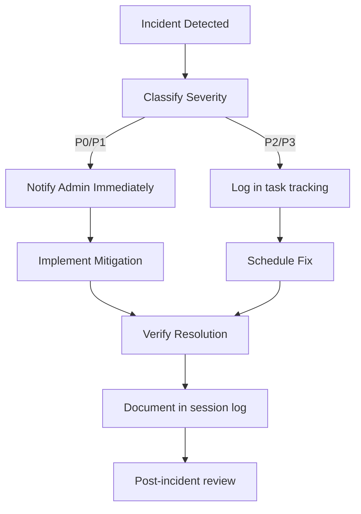

# 09-Operations-Runbook.md

# Operations Runbook — Đạo Ảnh / Tuệ Giác Số

**Document ID:** OPS-09  
**Version:** 1.0  
**Date:** 2026-10-08  
**Status:** Draft  
**Classification:** Internal — Operations  

---

## 1. Startup Procedures

### 1.1 Start Auth Gateway (Port 5001)

```bash
cd /opt/phatphakonline_gradio/truyenthua/visjs-app/Dai_Tang_Kinh/daoanh
python3 server.py
```

**Expected Output:** Flask development server running on port 5001  
**Verification:** `curl http://localhost:5001/daoanh/login.html` returns 200

### 1.2 Start Main Server (Port 5000)

```bash
cd /opt/phatphakonline_gradio/truyenthua/visjs-app/Dai_Tang_Kinh/daoanh
python3 app.py
```

**Expected Output:** Flask development server running on port 5000  
**Verification:** `curl http://localhost:5000/api/health` returns `{"status": "healthy"}`

### 1.3 Restart Main Server (VPS Production)

```bash
fuser -k 5000/tcp && nohup python3 app.py > flask.log 2>&1 &
```

### 1.4 Restart Auth Gateway

```bash
pkill -f server.py && python3 server.py &
```

### 1.5 Pre-Flight Checklist

Before starting servers, verify:

- [ ] SQLite database file exists: `data/lineage.db`
- [ ] Gemini API key configured as environment variable
- [ ] `data/backups/` directory exists and is writable
- [ ] Log files writable (`flask.log`, `app.log`)
- [ ] Nginx running (for production deployments)

---

## 2. Shutdown Procedures

### 2.1 Graceful Shutdown

```bash
# Stop main server
fuser -k 5000/tcp

# Stop auth gateway
pkill -f server.py
```

### 2.2 Emergency Shutdown

```bash
# Kill all Python processes related to daoanh
pkill -f "python.*app.py"
pkill -f "python.*server.py"
```

### 2.3 Pre-Shutdown Checklist

- [ ] No ETL scripts currently running
- [ ] No person import in progress
- [ ] Recent backup created (`data/backups/`)
- [ ] Admin notified (if production)

---

## 3. Monitoring Checklist

### 3.1 Daily Checks

| Check | Command | Expected Result |
|-------|---------|-----------------|
| Main server health | `curl http://localhost:5000/api/health` | `{"status": "healthy"}` |
| Auth gateway health | `curl http://localhost:5001/daoanh/login.html` | HTTP 200 |
| Database file exists | `ls -la data/lineage.db` | File present, non-zero size |
| Log files growing | `tail -n 20 flask.log` | Recent entries, no errors |
| Disk space | `df -h .` | > 20% free space |

### 3.2 Weekly Checks

| Check | Command | Expected Result |
|-------|---------|-----------------|
| Run full pipeline | `npm run pipeline` | All tests pass |
| Duplicate ID check | `npm run dup:ids` | Exit 0, no duplicates |
| Data honesty audit | `npm run audit:honesty:strict` | Pass |
| Backup verification | `ls -la data/backups/` | Recent backups present |

### 3.3 Alert Handling

| Alert | Severity | Response |
|-------|----------|----------|
| Server down (5000) | Critical | Restart: `fuser -k 5000/tcp && nohup python3 app.py &` |
| Auth gateway down (5001) | Critical | Restart: `pkill -f server.py && python3 server.py &` |
| Database file missing | Critical | Restore from latest `data/backups/` |
| Pipeline failure | High | Review test output, fix errors, re-run |
| Duplicate task IDs | High | Run `npm run dup:ids`, resolve conflicts per AGENTS §16 |
| Disk space < 20% | Medium | Clean logs, backups, or expand storage |
| Gemini API rate limit | Medium | Use translation cache; wait for reset |

---

## 4. Incident Response

### 4.1 Incident Classification

| Severity | Definition | Response Time | Escalation |
|----------|-----------|---------------|------------|
| **P0 - Critical** | System completely down; data loss risk | < 15 min | Admin + Build Agent |
| **P1 - High** | Core functionality impaired | < 1 hour | Build Agent |
| **P2 - Medium** | Non-critical feature broken | < 4 hours | Build Agent |
| **P3 - Low** | Cosmetic issue; documentation gap | < 1 day | Next sprint |

### 4.2 Incident Response Flow



### 4.3 Common Incidents

#### Incident: Server crash (port 5000 or 5001 unresponsive)

**Symptoms:**
- `curl` returns connection refused
- `flask.log` empty or shows traceback

**Response:**
1. Check process: `ps aux | grep python`
2. Kill stale process: `fuser -k 5000/tcp` or `pkill -f server.py`
3. Restart: `python3 app.py` or `python3 server.py`
4. Verify: `curl http://localhost:5000/api/health`
5. Document in session log

#### Incident: Database file missing or corrupted

**Symptoms:**
- `ls data/lineage.db` returns No such file
- API returns 500 on database queries

**Response:**
1. Stop servers immediately
2. Locate latest backup: `ls -t data/backups/lineage_*.db | head -1`
3. Restore: `cp data/backups/lineage_*.db data/lineage.db`
4. Verify integrity: `sqlite3 data/lineage.db ".tables"`
5. Restart servers
6. Document in session log

#### Incident: Git index.lock failure

**Symptoms:**
- `git add` fails: `fatal: Unable to write new index file`
- `WinError 5` or `Access denied`

**Response:**
1. Do NOT rename `.git/index` (cannot rename on this host)
2. Use temp-index sync pattern (AGENTS.md §14):
   ```bash
   export GIT_INDEX_FILE="$PWD/.git/wt_tmp_index"
   git read-tree HEAD
   git add -- <file>
   git diff --cached --name-only
   git commit -m "..."
   unset GIT_INDEX_FILE; rm -f .git/wt_tmp_index*
   ```
3. Verify: `git diff --cached --name-status`

#### Incident: Duplicate task IDs detected

**Symptoms:**
- `npm run dup:ids` fails
- Pipeline blocked at dup:ids step

**Response:**
1. Identify duplicates: `grep -rnE 'T[0-9]{3}' docs/tasktodo.md docs/Mimo-Flash/`
2. Change ID on side with smallest footprint (AGENTS §16)
3. Add `former_ids` reference
4. Update cross-references
5. Re-run `npm run dup:ids`

#### Incident: Gemini API rate limit exceeded

**Symptoms:**
- Translation API returns 429
- `polished_text` returns null

**Response:**
1. Check translation cache first
2. Fallback to GoogleTranslator
3. Wait for rate limit reset (1 minute)
4. Document rate limit in session log

---

## 5. Troubleshooting Guide

| Symptom | Possible Cause | Resolution |
|---------|---------------|------------|
| `curl localhost:5000` connection refused | Main server not running | Start: `python3 app.py` |
| `curl localhost:5001` connection refused | Auth gateway not running | Start: `python3 server.py` |
| API returns 401 on admin routes | Not authenticated | Login via /daoanh/login.html |
| API returns 403 on admin routes | Not admin user | Contact admin for access |
| API returns 429 | Rate limit exceeded | Wait 1 minute, retry |
| `npm run pipeline` fails at guard | Not in repo root | Run from `visjs-app` directory |
| `npm run pipeline` fails at dup:ids | Duplicate task IDs | Resolve per AGENTS §16 |
| Translation returns null | Gemini API down | Use cache or GoogleTranslator |
| Place search returns empty | Database not loaded | Check `data/lineage.db` exists |
| Map markers not displaying | Leaflet.js CDN blocked | Ctrl+F5 refresh or use Incognito |
| UTF-8 diacritics not matching | Search encoding issue | Use remove_diacritics() fallback |

---

## 6. Maintenance Activities

### 6.1 Daily Maintenance

- [ ] Check server health (`curl /api/health`)
- [ ] Review error logs (`tail app_err.log`)
- [ ] Verify backup directory writable
- [ ] Check disk space (> 20% free)

### 6.2 Weekly Maintenance

- [ ] Run `npm run pipeline` (full test suite)
- [ ] Run `npm run dup:ids` (duplicate ID check)
- [ ] Review session logs in `docs/sessions/`
- [ ] Verify backup retention (30 days)
- [ ] Clean old log files if needed

### 6.3 Monthly Maintenance

- [ ] Review source legal statuses (`data_sources` table)
- [ ] Audit admin access (who has admin privileges)
- [ ] Rotate any exposed secrets
- [ ] Review TTL file status (`docs/TTL-FILE-STATUS-REPORT.md`)
- [ ] Update tasktodo.md (mark completed tasks)

### 6.4 Quarterly Maintenance

- [ ] Full security review (threat analysis update)
- [ ] Performance review (query response times)
- [ ] Disaster recovery drill (restore from backup)
- [ ] Documentation review (update outdated docs)
- [ ] Dependency audit (`npm audit`)

---

## 7. Contact Information

| Role | Contact | Responsibility |
|------|---------|----------------|
| **Admin (No-coding)** | Admin email | Source integration approval, canonical decisions, legal checks |
| **Build Agent (ClaudeCode)** | Build channel | Feature implementation, bug fixes, ETL scripts |
| **Plan Agent** | Plan channel | Architecture design, spec creation, technical debt |
| **Tester Agent** | Test channel | QA testing, pipeline execution |
| **Security Team** | Security channel | Security reviews, threat analysis |

---

## 8. Emergency Contacts

| Scenario | Contact | Method |
|----------|---------|--------|
| **Server down (production)** | Admin | Email + phone |
| **Data corruption** | Build Agent | Build channel |
| **Security breach** | Security Team | Security channel |
| **Legal/compliance issue** | Admin | Email |
| **Gemini API key compromise** | Build Agent | Build channel (rotate key) |

---

## 9. Documentation References

| Document | Location | Purpose |
|----------|----------|---------|
| **AGENTS.md** | Root directory | Session protocol, server architecture, commit rules |
| **API_DOCS.md** | Root directory | API endpoint documentation |
| **SYSTEM_MAP.md** | Root directory | System overview, key statistics |
| **SCHEMA.md** | Root directory | Database 3-layer model |
| **FEATURE_PLAN.md** | Root directory | Feature roadmap |
| **SOURCE_REGISTRY.md** | docs/ | Data source registry with legal audit |
| **SOURCE_INTEGRATION_ARCHITECTURE.md** | docs/ | Source integration patterns |
| **ROADMAP.md** | docs/ | Data source integration roadmap |
| **tasktodo.md** | docs/ | Active task list |
| **opencode-directives.md** | docs/ | OpenCode integration directives |
| **01-System-Overview.md** | /GeneratedDocs/ | Enterprise system overview |
| **02-Solution-Architecture.md** | /GeneratedDocs/ | Solution architecture with Mermaid diagrams |
| **03-Technology-Stack.md** | /GeneratedDocs/ | Technology stack documentation |
| **04-Software-Design-Specification.md** | /GeneratedDocs/ | Software design specification |
| **05-API-Specification.md** | /GeneratedDocs/ | API specification |
| **06-Database-Design.md** | /GeneratedDocs/ | Database design with ERD |
| **07-Deployment-Architecture.md** | /GeneratedDocs/ | Deployment architecture |
| **08-Security-Architecture.md** | /GeneratedDocs/ | Security architecture |
| **10-Open-Questions.md** | /GeneratedDocs/ | Open questions and assumptions |

---
